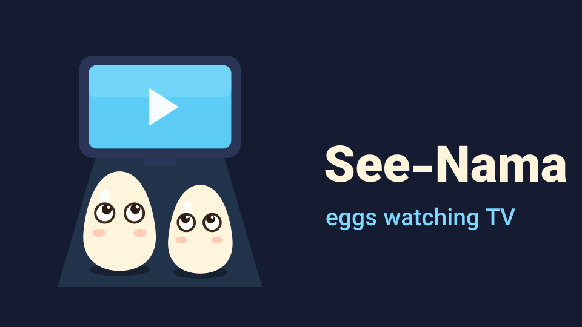

# see-nama

<p align="center"></p>

A native Android TV client for 30nama with a Netflix-style UI. It replaces the
official React Native "30TV" app (v3.2.3) and talks to the same backend.

> **Unofficial.** This project is not affiliated with or endorsed by 30nama. It needs a 30nama
> account to use.

## Build & install

First add the backend's platform key (the `c-api-key` header the official Android TV app sends)
to `local.properties`, which is git-ignored. You can also set the `NAMA_API_KEY` environment variable instead:

```properties
namaApiKey=<platform key>
```

```sh
./gradlew :app:assembleRelease          # app/build/outputs/apk/release/app-release.apk (~3 MB)
adb install -r app/build/outputs/apk/release/app-release.apk
```

The release build is minified with R8. To sign it with your own key, create a `keystore.properties`
in the project root (it is git-ignored):

```properties
storeFile=keystore/your-release.jks
storePassword=...
keyAlias=...
keyPassword=...
```

Without that file the release build falls back to the debug key, so it still builds and installs.

## Third-party assets

The Vazirmatn font (`app/src/main/res/font/`) is licensed under the SIL Open Font License 1.1.
See `third_party/vazirmatn-OFL.txt`.

**Debug demo mode.** Debug builds can serve fake data, which is handy for UI work without an
account or network:

```sh
./gradlew :app:installDebug
adb shell am start -n com.seenama.tv/.MainActivity --ez demo true
```

## Stack

Kotlin, Jetpack Compose for TV (`androidx.tv:tv-material`), Media3/ExoPlayer (HLS), Coil 3 and OkHttp.
There is no React Native, WebView or JW Player.

| Path | What |
|---|---|
| `data/Api.kt` | `POST {endpoint}/action/{name}`, form-encoded. Mirror discovery works like the original: test the stored host, then race `endpoint`, the R2 list and the ArvanCloud list, then race `test` across the mirrors. |
| `data/Repository.kt` | All actions plus in-memory caches (details, pages, short-lived stream links). |
| `data/Models.kt` | Defensive JSON mapping. The backend mixes types, so models aren't strict serializers. |
| `ui/home` | Billboard plus rows. The focused card stays anchored, rows above fade, and the backdrop follows focus. |
| `ui/details` | Header, Play/Resume, My List, Favorite, Notify, the season/episode picker and cast. |
| `ui/search` | On-screen keyboard with debounced as-you-type search. |
| `ui/browse`, `ui/mylist` | Categories and genres; archive grids with sort options; the watchlist/favorites/notify lists. |
| `player/` | ExoPlayer, scrubbing, skip intro/recap, next-episode countdown, the audio & subtitles panel, quality, progress reporting and the VAST pre-roll. |

## Features beyond the original app

| Area | What it does |
|---|---|
| **Instant start** | The last home screen is cached on disk, so a cold start shows it in about 0.5 s (release build) and refreshes in the background. |
| **Resilience** | Retries use exponential backoff with jitter, and only transient errors are retried. Requests wait for the network instead of failing. If a mirror is blocked, the app switches to another one automatically. |
| **Player recovery** | Network errors show "Reconnecting…" and playback resumes where it stopped. Expired links are fetched again. Decoder errors fall back to a lower quality. |
| **Server status** | A dot on the profile tile shows green, amber or red. The expanded rail shows the server and its latency. Offline and back-online banners appear when needed. Settings → Server tests every mirror and lets you pick one. |
| **Notifications** | Bell with an unread badge, a list in English (generated from Persian payloads), mark as read, a toast when a new episode arrives, and polling while the app is in the foreground. |
| **Discovery** | Ratings strip (IMDb with vote count, Rotten Tomatoes, Metacritic, MyAnimeList). Real episode titles, stills, synopses and air dates, plus airing status and the next-episode date ([TVmaze](https://www.tvmaze.com/api)). An About section from Wikipedia with a QR code. Cast photos. Trailers open in the YouTube app. |
| **Recommendations** | Top 10 row with ranked posters, "Because you watched…" rows, and More Like This (genre + type, best rated). Everything comes from the 30nama catalog, so it is all playable. |
| **News** | Variety, Deadline and IndieWire RSS: a top story, source filters, a reader with a QR code for the full article, and "Find on 30nama" for titles mentioned in a headline. |
| **Settings (persisted)** | Autoplay next episode, auto-skip intros/recaps, default subtitles, subtitle size, preferred quality, server choice, recent searches, clear cache. |

None of the external sources need an API key, and all of them are cached with a TTL. Failures are silent: these sources only add information and never block the UI.

## Debug-build test hooks

```sh
# Fake backend (no account/network needed)
adb shell am start -n com.seenama.tv/.MainActivity --ez demo true
# Simulate losing / regaining the network (all requests incl. video segments fail)
adb shell am start -f 0x20000000 -n com.seenama.tv/.MainActivity --ez offline true
adb shell am start -f 0x20000000 -n com.seenama.tv/.MainActivity --ez offline false
# Show the "new episode" toast for the latest notification
adb shell am start -f 0x20000000 -n com.seenama.tv/.MainActivity --ez toast true
# Call any API action once; raw responses are logged under the ApiRaw tag
adb shell am start -S -n com.seenama.tv/.MainActivity --es probe notification --es params page=1
```

## Backend notes

These were reverse-engineered from the 3.2.3 bundle. Details are in `docs/`.

- **Headers:** `c-api-key` (the ANDROIDTV key), `c-token` (the session), `c-version-number: 1.0.0`, `c-language: en`.
- **Login:** QR flow. `qrlogin_code` returns `{code, url}`. Poll `qrlogin_login(auth_code)` every 5 s until it returns `token`.
- **Episodes, qualities, subtitles and skip markers** all come from `stream`. `single` has no episode list.
- **Progress:** `observer(post_id, file_id, user_id, time, duration, token)` is sent every 15 s and on pause/exit. It powers Continue Watching. The server replies **HTTP 204 with an empty body** on success.
- **Notifications:** `notification(page)` returns `{notifications[], total_unread}`. The text is Persian only; `notification_read(notification_id)` marks one as read.
- **Full `home`** (not `home_stream`) adds `top_10` and `new_releases`. Filter them on `options.stream`.
- **Subtitles** are `.srt` files served from the API host, which is behind Cloudflare, so requests must send the browser user agent.
